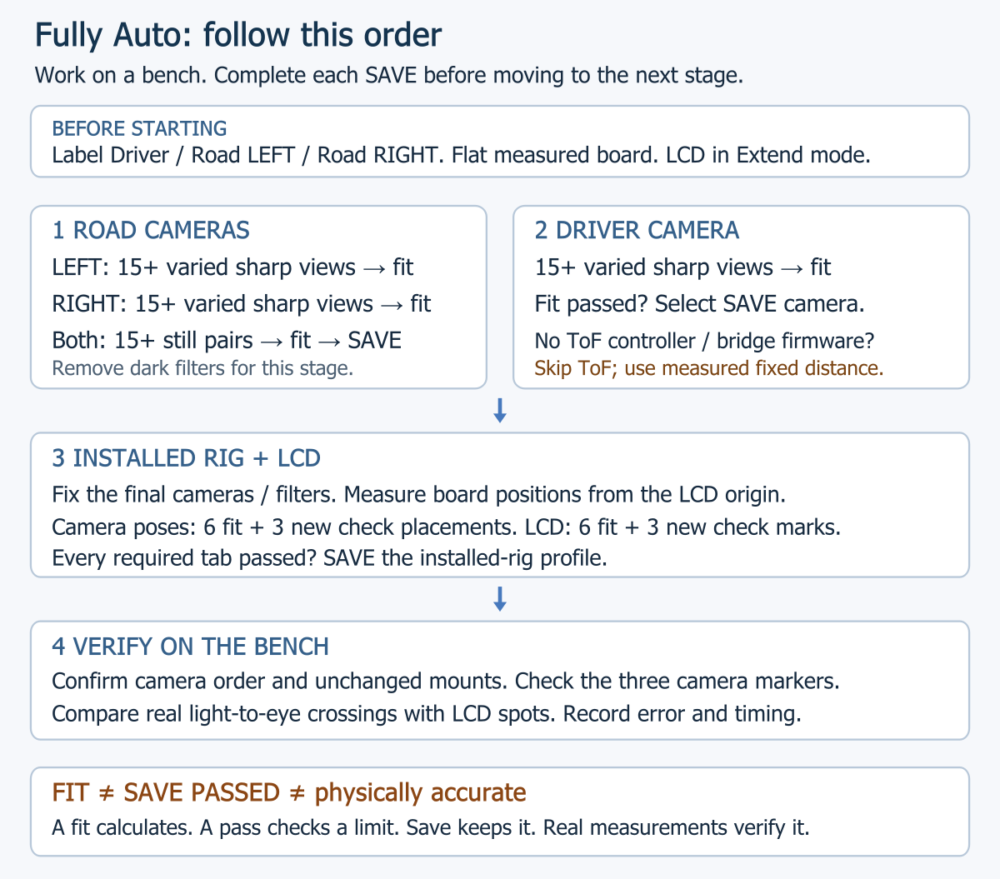
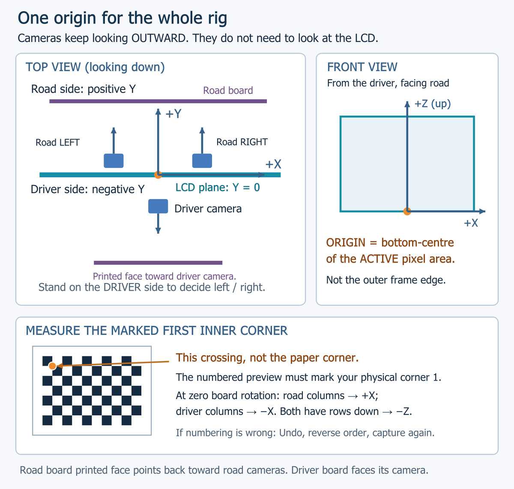
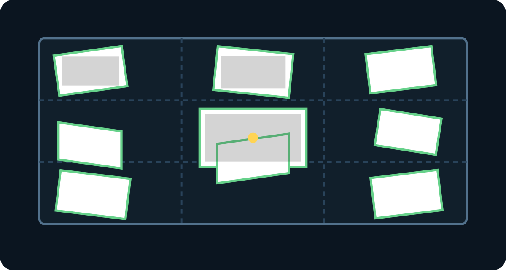

# Driver and installed-rig calibration

Reviewed against the development source on **2026-11-27**. This describes the current
source, not a new standalone release. An older executable may have different controls.

Start with the illustrated [offline operator manual](../../assets/calibration/offline_manual.html).
It opens in a browser and includes its pictures: copying this HTML file preserves
the illustrated instructions. Save the printable chessboard PDF separately. Online
videos and source links require internet; no calibration step depends on playing them.

The purchased VL53L0X has no commissioned controller/bridge firmware yet. Use
**Skip ToF for now**, **Live driver distance OFF** and a measured **Fixed distance**
until that hardware is assembled and tested. For the sensor route, use the separate
[ToF sensor offline setup guide](TOF_SENSOR_OFFLINE_SETUP_GUIDE.md), which includes
wiring, signed offsets, examples and recovery.



## Before opening calibration: prepare the main window

Complete these steps **before** opening **3. Installed rig + LCD**. That dialog is
modal: the main settings cannot be edited while it is open, and its camera/display/
dimension binding is captured on entry. Closing it discards unsaved captures and
fits; archived evidence is not an automatic resume facility.

1. Select **Stop**, close other webcam applications and wait for camera discovery.
2. Connect the prototype LCD. Press **Win + P > Extend** in Windows. Check the laptop
   and LCD can show different content. Set the intended resolution/orientation and
   leave it unchanged through calibration and testing.
3. Open **Operation > Operating Mode**. Choose **Fully Auto** for the complete
   three-camera rig and turn **Show advanced configuration ON**.
4. In **Cameras > Camera Selection**, assign the driver camera and external Road
   LEFT/RIGHT cameras. Cover one lens briefly to verify physical identity instead
   of trusting its number. If using the integrated-camera lock, verify its selection.
5. In **Geometry > Windshield**, choose the **Panel preset** or Custom and verify
   the measured active-pixel **Width** and **Height**. Exclude the bezel/frame. The
   HP preset is a starting value, not a substitute for measuring this LCD.
6. In **Research > Prototype Display Output**, select the actual non-primary LCD
   under **Target display**. Use **Refresh** if needed. Keep **Use prototype display
   during Run ON** and initially choose **White (clear)**.
7. Select **Corners + center** under **Test pattern**, click **Show test**, and check
   it appears on the intended LCD. Click **Close output** afterwards. This checks
   routing/orientation, not optical transparency or geometric accuracy.
8. Save the app, local guide and board PDF on the test laptop. Disconnect Wi-Fi and
   reopen them. Confirm the pictures, PDF, camera drivers and USB devices work.

If one of these settings must change later, correct it before starting the installed
session. Do not wait until LCD mapping to select the monitor.

## Stable driver distance and the toolbar centre button

1. Open **Driver > Driver Distance**. Leave **Live driver distance OFF** for the current
   no-controller bench setup. Set **Fixed distance** to your measured driver-camera
   optical-axis distance to the eye plane; the initial value is 50 cm. Stay at that
   distance. Eye position tracking and optional drowsiness landmarks continue updating.
2. OFF bypasses jittering IPD/PnP range estimates and does not open a ToF connection.
   It uses a declared reference, not a measured distance. The fixed field is editable;
   ON grays it out and restores live camera IPD or selected calibrated ToF.
3. In a camera-based preview, choose Run, wait for fresh eyes and click **Calibrate
   Center**. X/Z recenter immediately and both-eye separation stays intact. A status-bar
   message confirms the action. Distance is preserved. This is preview centering, not
   checkerboard or installed-rig calibration.
4. The button is disabled when eyes are missing/stale, outside Run, in manual-driver
   modes, during LCD testing, or when installed coordinates are active. Hover to read
   the reason. Installed coordinates must use the third calibration dialog instead.

Distance mode and the fixed value persist across restarts. Changing them resets the
preview reference and rejects old queued frames. A selected live ToF that fails never
silently falls back to IPD. Explicit Skip ToF uses IPD only when live distance is ON;
with it OFF, the fixed reference is used instead. If the camera lacks intrinsics,
unprojection remains an approximate preview and live IPD is unavailable.

## 1. Choose the mode, then open Cameras > Calibration

Settings start collapsed. Select the Camera icon, then click the Calibration header
(or focus it and press Space/Enter) to reveal its buttons. Expanded settings now have
more spacing; Driver, Road lights, Geometry and Research use profile, bulb, monitor
and microscope icons respectively.

Road preview check: both panes show the full raw image with equal canvas sizing and
aspect-preserving letterboxing. Read each camera's raw pixel dimensions above its
pane. LEFT may be a frozen last view while RIGHT is live; different board poses at
those stages cannot be used to compare zoom. Compare the same stationary board in the
paired stage instead. Equal resolutions do not guarantee equal focal length/FOV.
Native mode mismatches are rejected rather than hidden by rescaling. The dialog body
scrolls on smaller screens while capture/fit/save/close actions remain accessible.

| Mode | Component calibration buttons | Installed rig calibration |
|---|---|---|
| Fully Auto | Road stereo and driver camera/ToF | Road LEFT pose, driver pose, LCD mapping |
| Driver Position Fixed | Road stereo | Road LEFT pose and LCD mapping; enter measured eyes manually |
| Headlight Position Fixed | Driver camera/ToF | Driver pose and LCD mapping; enter measured lamps manually |
| Fully Manual | Neither camera component | LCD mapping; manual geometry can also use nominal panel dimensions |

Driver and installed-rig calibration stop live tracking before using a camera.
Road stereo retains its existing requirement to select Stop first. Wait for camera
discovery to finish. Close any other application using the webcams.

## 2. Driver camera, independently of ToF

1. Open **2. Driver camera + ToF**, select **1. Driver camera**, and open its
   **Camera and ToF guide...** if needed.
   The guide has separate ordered Camera and ToF tabs.
2. Print the supplied A4 board at 100%, measure its squares, and attach it to rigid,
   completely flat backing. The pattern has 9 x 6 inner corners / 10 x 7 squares.
3. Enter the measured square side. The supplied PDF uses 2 cm squares. The IPD field
   defaults to a 6.3 cm estimate; measure the participant's separation for IPD testing.
4. Click **Start camera**, then **Capture view** for at least 15 sharp views covering the image,
   several distances, and gentle tilts. Move the board; keep final camera focus fixed.
   Very similar views are rejected. Reset captured views if the target/setup was wrong.
5. **Fit camera**, inspect the intrinsic RMS and actual image size, then explicitly
   **Save camera profile**. A fit alone does not activate a profile. Save shows a
   success alert. The existing saved profile survives a failed retry.
6. With no controller, select **2. ToF sensor** and **Skip ToF for now**. Its indicator says
   skipped. Camera calibration and sensor calibration have separate skip controls.
   **Use saved camera profile** reverses the camera skip. **Use saved ToF profile**
   also requires a running connection and fresh valid packets identifying the same
   calibrated sensor; follow the [sensor reuse steps](TOF_SENSOR_OFFLINE_SETUP_GUIDE.md#e4-reuse-a-saved-profile-after-reconnecting-the-same-sensor).
7. Dismiss the saved alert and **Close** the dialog so the app reloads the profile.
   For today's no-controller route, set **Driver > Driver Distance > Live driver
   distance OFF**, enter the measured **Fixed distance**, and stay at that depth.

The driver preview is mirrored for convenience during tracking; calibration and
measurement pixels stay native and unmirrored. Calibration and live capture request
the same driver-camera mode. A changed actual frame size invalidates reconstruction.

## 3. ToF, after a controller is assembled

1. The host expects the [bridge v1 protocol](../reference/TOF_BRIDGE_PROTOCOL.md).
   Controller firmware and physical wiring are still outstanding. A sketch printing
   one distance number per line cannot supply the required identity, quality and times.
2. Mount the sensor close to the driver camera with parallel forward axes. Fix its
   position. This first fusion model assumes a centred, near-frontal face; it does not
   solve arbitrary sensor-to-camera rotation or identify which object returned light.
3. Select its **USB serial port** and click **Connect / reconnect**. Wait for actual
   **Valid range** messages and the expected sensor identity. Only synchronized valid
   packets are accepted; an ordinary distance-demo sketch is not compatible firmware.
4. Use a stable flat target that fills the sensing area. Measure from the sensor's
   reference surface. Capture 20 stable readings at each of three distinct **fit**
   distances and two additional **validation** distances spanning the seating region.
   Example sequence: fit 30/50/70 cm, validation 40/60 cm. Do not reuse distances.
5. Enter the signed sensor-to-camera Z offset in the camera's forward direction.
   Separately measure the facial surface-to-eye-plane Z correction. Confirm both;
   do not invent a zero offset. Target capture calibrates range bias, not human eyes.
6. **Fit and Save ToF** fits bias from fit samples only and checks the separate validation
   samples. A success alert records only that range-profile check. Reset samples if
   references or sensor identity were wrong; previous saved profiles remain intact.
7. Independently compare fused eye depth with measured truth on the final mount,
   including glasses and incoming glare. A single-zone return can come from a hand or
   background. No pupil depth or drowsiness claim follows from a range fit alone.

Live depth is approximately `raw range + bias + sensor Z offset + eye-plane correction`.
The first model accepts head pitch/yaw within 10 degrees and an eye midpoint within
5 degrees of the camera axis. It requires a compatible sensor identity and fresh
range paired with the camera observation. Invalid ToF clears the measured output;
it never silently falls back to IPD. With live distance ON, explicit Skip ToF selects
the IPD bench estimate. With live distance OFF, the entered fixed reference is used.

## 4. Installed rig: the third calibration

```text
Driver (-Y)       LCD plane Y=0         Road (+Y)
driver cam <---   | active panel |   ---> road LEFT + RIGHT
ToF        <---   |              |

Origin = bottom-centre of active pixels; X lateral, Z up; all distances in cm.
```

Positive X means the driver's right while looking through the LCD toward the road.
Measure all camera/board coordinates using that one convention, including when
standing on the opposite side of the rig.



The permanent cameras keep facing their subjects. They do not look at the LCD.
Put the board on the side each camera sees. Finish component calibration first,
install the final optics without moving/refocusing the cameras, and freeze the rig.

**Check visibility through the final filters before starting.** The complete board
must remain sharp and detectable in the required road views. Improve board lighting
without moving the rig. If dark filters prevent reliable detection, stop this stage
and resolve visibility/the optical setup. Removing a filter to obtain a fit does not
validate the final filtered configuration. Keep unverified results as development
previews rather than claiming physical accuracy.

### 4A. Open the installed session after preparation

1. Recheck the main-window mode, selected secondary display and active width/height.
   Open **Cameras > Calibration > 3. Installed rig + LCD**.
2. In Fully Auto the tabs are **1. Road installed pose**, **2. Driver installed pose**
   and **3. LCD physical mapping**, in that order. Fewer required camera roles change
   the numbering. Do not look for a separate Road RIGHT pose tab.
3. Enter a meaningful **Physical rig / mount revision**, for example `rig-v1-flat-board`.
   Check **Camera order and mounts checked** only after verifying the physical devices.

### 4B. Measure and fit the road-side board placements

1. Use a temporary rail/square stand to hold the rigid board at measured positions
   on the road side. Free-hand waving is appropriate for varied lens views, not this
   measured stage. Enter **Measured square side**.
2. Physically mark the board's **first inner corner**. Measure that corner's XYZ from
   the LCD origin. It is an inner checkerboard intersection, not the paper edge,
   square edge or mounting screw.
3. Prefer a board made parallel to the LCD using a square/stand. With zero rotations,
   road-board columns progress along LCD **+X**, rows down **-Z**, and Y is positive.
   Enter zero rotations only when that alignment is physically established.
4. Click **Start preview**. Enter **First inner corner** XYZ and **Measured rotations**.
   Set **Placement use** to **fit**, check **The measurements and marked corner match
   this view**, then click **Capture measured placement**.
5. The preview freezes with corner **1** marked. Compare it to the physical mark.
   If wrong, click **Undo last placement**, **Resume preview**, correct the measurements
   or **Reverse detected corner order (180 degrees)**, and capture again.
6. Click **Resume preview** before each new capture. Collect six different fit
   placements across at least three measured Y depths. Then select **validation**
   and collect three new placements; do not reuse fit positions.
7. Click **Fit / validate installed pose**. Proceed only when **POSE PASSED** appears.

Example plan only: choose road depths such as +70, +90 and +110 cm, with two different
measured X/Z placements at each depth. Use three new positions for validation. Use
only positions the real board, measuring stand and camera field of view support;
do not enter these numbers without measuring the corresponding placements.



### 4C. Repeat for the driver-side camera

Use **2. Driver installed pose** and repeat six fit placements at three or more
depths, then three separate validation placements. Driver-side Y is **negative**.
At zero rotation its board columns progress along LCD **-X**, with rows down **-Z**.
For example, a suitable rig might use -40/-50/-60 cm fit depths; independently measure
every location and choose new validation positions. Inspect the frozen corner 1
after every capture and continue only after **POSE PASSED**.

Prefer measured parallel placements with rotations zero. If using a tilted board,
measure right-hand rotations about LCD X/Y/Z; the software composes `Rz * Ry * Rx`.
Do not estimate angles by eye. Road RIGHT is related to LEFT through the saved stereo
rotation/translation, so it needs no separate LCD pose fit. The rigid relationship
and LEFT/RIGHT order must remain unchanged.

### 4D. Measure the physical LCD marks in the same open dialog

1. Select **3. LCD physical mapping**, choose target 1 and click
   **Show mark on selected LCD**.
2. Measure the real mark's X/Z from the active-area bottom-centre. Enter
   **Measured X** and **Measured Z**; left of origin is negative X.
3. Check **I measured this mark on the actual LCD active area**, then click
   **Capture measured mark**. The captured count increases and the next target is
   selected automatically. Show each new mark before measuring it.
4. Complete all nine targets: six FIT marks and three VALIDATION marks. Do not copy
   software-calculated nominal positions into the measured fields.
5. If a measurement was wrong, use **Undo last mark**, show it again and remeasure.
   Click **Fit / validate LCD mapping** and wait for **LCD mapping PASSED**.

If no usable secondary LCD is selected, close the dialog, correct Extend/Target
display settings on the main window, and start a new installed session. **Closing
discards this dialog's unsaved camera placements/fits and LCD measurements.**

### 4E. Save, dismiss and close before expecting live results

1. Confirm every required camera pose and the physical LCD mapping passed.
2. Click **Save installed rig profile** and wait for the **Installed rig calibration
   saved** alert. If an error appears, a new successful save has not occurred.
3. Dismiss the alert, then click **Close**. The app reloads the saved profile and
   refreshes the 3D camera markers after the dialog closes. Leaving the save alert
   or dialog open is not the completed return-to-tracking workflow.
4. Back under **Cameras > Calibration**, verify physical camera identities/order
   and unchanged mounts, then turn **Confirm camera order and mounts ON**. This is
   required each launch because camera indices may change.
5. Check **Installed mapping ready**. The no-ToF route also identifies its fixed
   eye-depth reference. Select **Run** for tracking and output.

Changes to camera selection, intrinsic/stereo calibration, selected display mode or
panel dimensions invalidate the relevant binding. Remounting/refocusing must be
reported by the operator; software cannot physically detect every mount change.

### Reading the camera rig in the 3D view

After saving **and closing** the third calibration dialog, compatible saved camera
poses appear automatically. Driver, Road L and Road R require both accepted installed
camera roles, matching driver/stereo profiles and ordered camera indices, matching
LCD/dimensions, and a compatible stereo profile for two different road indices.
Enable **Camera positions** in 3D view settings. Modes with fewer calibrated roles
need not show all three. Their optical-centre points use the same centimetre
coordinates as the LCD plane; arrows show camera viewing direction. They do not depict
measured camera-body size or lens field of view. RIGHT is positioned/oriented through
the saved stereo R/T, not by guessing half the baseline from a manual camera position.

Hover over the rig-status text at the bottom of the scene to read X/Y/Z coordinates.
In 3D view settings, Camera positions hides/shows the markers. Saved poses awaiting
mount confirmation are identified separately; confirm camera order and unchanged
mounts before Run. Changing the selected cameras, their calibration, panel dimensions
or display invalidates affected saved markers. If calibration is incomplete, the scene
keeps an explicitly uncalibrated/demo reference instead of inventing real positions.

Lens/stereo fitting alone does not establish camera-to-panel locations. Finish the
installed-rig workflow, then independently verify physical intersections. The example
image in the thesis reference uses synthetic test poses and is marked OFFLINE EXAMPLE.

During **Run**, the selected non-primary LCD opens fullscreen with its selected clear
state and authorized spots. **Standby** and **Stop** close the output window and return
that display to its desktop. Missing or incompatible observations clear camera-derived
spots. A white screen alone does not establish optical transparency or attenuation.

## Backups and source/standalone transfer

Close the app before copying calibration data.

| How the app runs | Calibration root |
| --- | --- |
| Python/source from this project | `calibration` beside `run.py` |
| Frozen standalone executable | `%LOCALAPPDATA%\GlareTracker\calibration` |

Keep the whole calibration root, including `installation` profiles and evidence
subfolders. These source and standalone locations are separate; there is no automatic
migration. Before manual transfer, close both apps and back up the destination folder.
Copy deliberately to the intended root, then reselect/verify cameras, LCD, active
dimensions and sensor port and confirm unchanged mounts. Do not assume UI preferences
transfer with calibration files. Use records only for the same physical assembly and
compatible capture modes.

A failed fit/save preserves the previously saved successful profile. Closing an
unsaved dialog loses its in-memory session work. Keep a dated measurement sheet and
archived evidence as well as the accepted profile.

## 5. What passes, and what still needs measurement

These are prototype defaults declared before fitting, not established thesis accuracy:

| Check | Software limit |
|---|---|
| Driver intrinsic fit RMS | <= 1.5 px |
| Installed pose fit and held-out RMS | <= 1.5 px each |
| Held-out known point to observed ray, transverse distance | <= 2 cm maximum |
| Held-out measured LCD marks | <= 0.3 cm maximum |
| ToF target readings | >= 20 per distance, standard deviation <= 1 cm |
| ToF held-out median corrected range | <= 2 cm error |

Pose validation checks ray agreement; it does not independently validate depth along
the ray. For real accuracy, use independently measured eyes and lamps, both eyes,
multiple lights and depths, panel edges, and the final filters. Record actual spot
error and latency using the existing physical protocols. A saved-profile alert does
not establish an end-to-end accuracy or optical attenuation result.

The physical-output watchdog clears camera-derived spots for missing, incompatible,
old or poorly paired observations. Current limits are 200 ms camera receipt age,
50 ms camera-pair/readout skew and 100 ms range age. Ordinary webcams provide host
readout times rather than synchronized exposure timestamps; these checks do not prove
hardware synchronization or external photon-to-LCD latency.

References: [OpenCV camera calibration and pose conventions](https://docs.opencv.org/4.x/d9/d0c/group__calib3d.html)
and [ST VL53L0X datasheet](https://www.st.com/resource/en/datasheet/vl53l0x.pdf).
