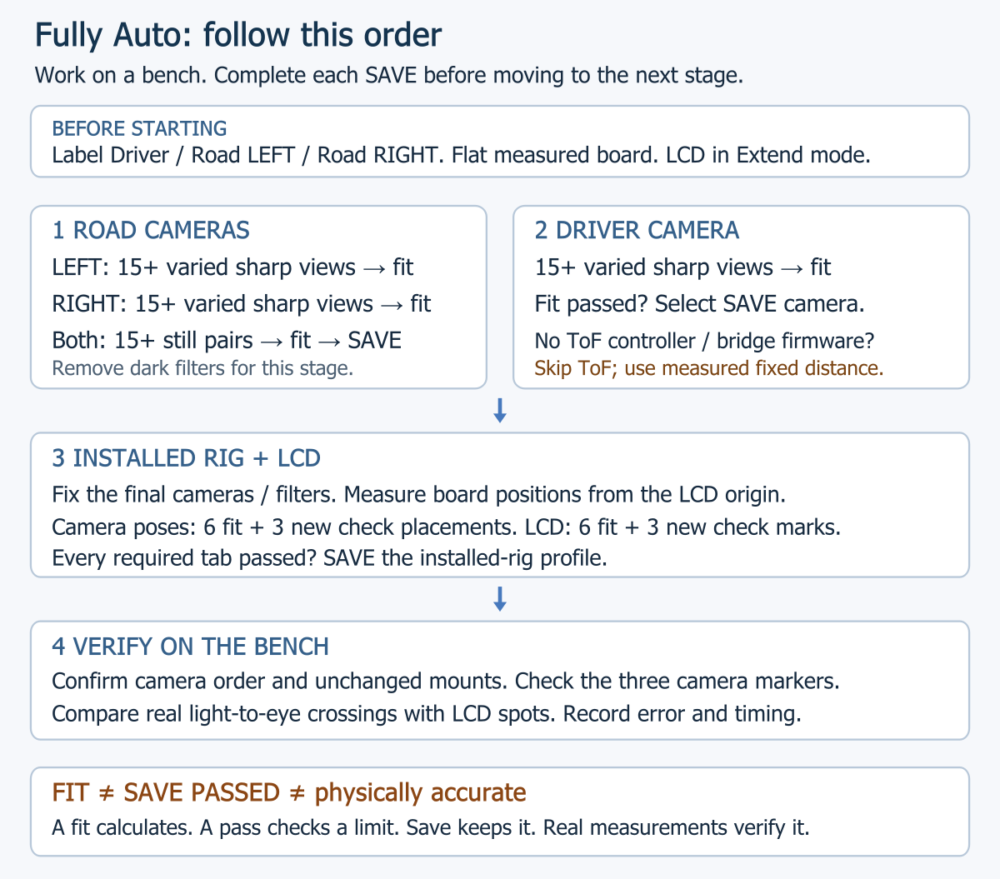
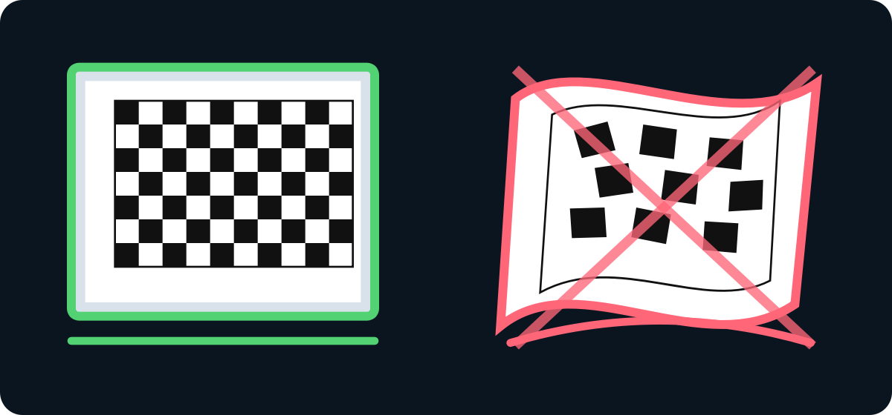
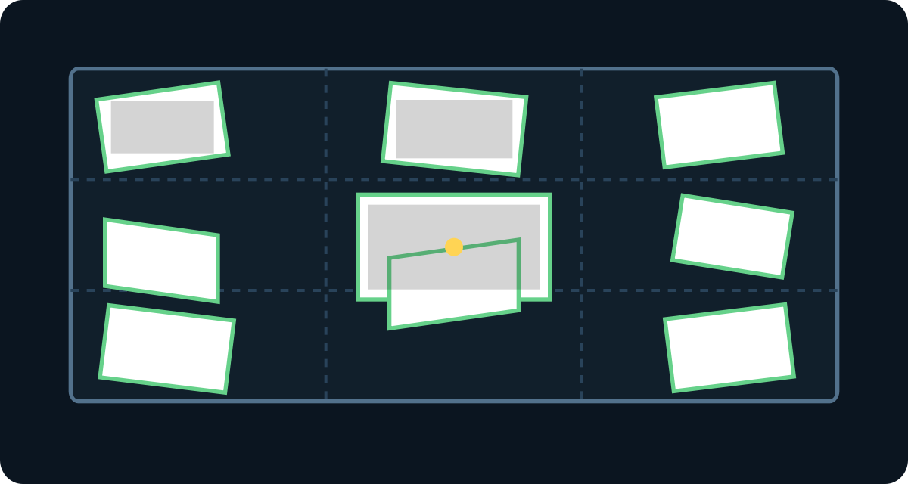
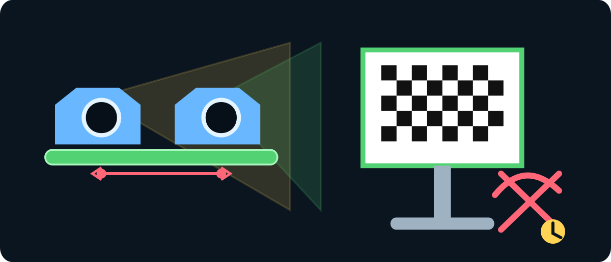

# Road Stereo Chessboard Setup Guide

Updated: 2026-11-27. This is a stationary bench procedure for the two road-facing
cameras. The third, driver-facing camera has a separate calibration.

**Offline starting point:** open the bundled
[illustrated calibration manual](../../assets/calibration/offline_manual.html)
in a browser. It includes the complete sequence and local images; internet access
is not needed for its instructions. Keep the application, its assets and its
calibration folder together. Use the application’s **Print A4 chessboard...**
button, or open the [supplied printable PDF](../../output/pdf/road_stereo_chessboard_A4_9x6_20mm.pdf).

## 1. Prepare the equipment

1. Choose **Stop** on the main toolbar. Wait for camera scanning to finish and
   close Windows Camera, video-call software and other applications using webcams.
2. Label the physical devices **Driver**, **Road LEFT** and **Road RIGHT**. Decide
   LEFT/RIGHT while standing on the driver side and looking toward the road.
   Do not decide it from a mirrored selfie preview.
3. Fasten the two road cameras side by side on a rigid bar. Their views must
   overlap enough to show the same complete board. Move the board during this
   procedure; keep the cameras and their focus fixed.
4. Measure between the centres of the two lenses and write down that separation.
   This is the **baseline**, not the gap between the cases.
5. Remove the dark filters for this first component-calibration pass. Fit them
   again only after saving, without shifting or refocusing the cameras. The final
   filtered setup needs geometric checks before accuracy measurements.

Camera numbers can change after unplugging. Although one installation used Driver 0
and Road 1/2, those numbers are not a permanent promise. Check the actual feeds and
device names every session. This application requests a shared 640 × 480, 15 FPS
road-camera mode; the preview’s native-size labels show what was actually received.

## 2. Prepare and measure the board

1. Print A4 landscape at **Actual size / 100%**. Turn off **Fit to page**.
2. Keep the white border. Glue the complete sheet to rigid, flat backing. Do not
   use a loose, folded or hand-bent sheet.
3. Count **inner corners**, the crossings inside the pattern: **9 across and
   6 down**. The sheet has **10 × 7 squares**.
4. Measure across several squares, then divide. For example, if five square sides
   span 10.0 cm, enter **2.000 cm** as **Measured square side**. A designed 20 mm
   square equals 2.0 cm, but use the ruler result after printing.
5. Check that all black/white boundaries are sharp and that there is no glare,
   blur, tape, finger or clip over the pattern.

A low pixel fit error does not prove the printed square size is correct. Wrong
square units can give a plausible-looking fit with the wrong distance scale.

## 3. Open the correct controls

All settings sections start collapsed. Click a section header to open it; keyboard
users can focus a header and press Space or Enter.

1. Open **Operation**, expand **Operating Mode**, and select **Driver Position
   Fixed** for an initial road-camera bench test. The driver camera remains
   assigned but is not used for that mode’s live eye measurements.
2. Select the **Cameras** context icon and expand **Camera Selection**.
3. Use the fields **Driver**, **Road left** and **Road right** to assign the actual
   devices. If needed, select **Refresh cameras**, wait, then check the choices
   again. The normal interface already uses stereo for the road pair; no separate
   setup selection is needed.
4. Expand **Calibration**, then choose **1. Road stereo calibration**.
5. In that window check the LEFT and RIGHT camera numbers, **Inner corner columns
   = 9**, **Inner corner rows = 6**, and your measured square side.

A startup calibration offer may open the same workflow. It does not replace these
identity and board-size checks.

## 4. Collect LEFT camera views

1. Select **Start LEFT calibration**. Confirm the LEFT feed is the expected camera.
2. Place the complete board in the centre. Stop moving it, then choose
   **Capture LEFT view** once.
3. Check the counter. Only an accepted view increases it. If the message says the
   board was missing or the view was too similar, correct that condition first.
4. Capture at least **15 accepted views**. Use the centre, left, right, top and
   bottom areas, several distances, and gentle horizontal/vertical tilts.
5. Select **Fit LEFT intrinsics** when enabled. “Intrinsics” means this camera’s
   lens/image model, including focal length and distortion.
6. Wait for the LEFT pass alert. The dialog then moves to the RIGHT stage.

Do not fill the counter by clicking repeatedly on an unchanged board. Fifteen
accepted views are a minimum, not a reason to keep poor photographs.

## 5. Repeat for RIGHT

1. Select **Start RIGHT calibration**. Check that its physical camera and native
   image dimensions are correct.
2. Repeat the complete set of at least **15 accepted, varied sharp views**.
3. Select **Fit RIGHT intrinsics**, then wait for the RIGHT pass alert.

Different apparent board sizes can result from different focal lengths or camera
positions. Each camera keeps its own lens model. Equal width/height does not prove
identical optics. A native-resolution mismatch warning must be corrected; do not
resize an image or change the measured square size to make the previews look equal.

## 6. Calibrate the fixed pair

1. Check again that the pair is rigid, ordered correctly and focused. Keep this
   arrangement unchanged for all remaining pair captures.
2. Select **Start STEREO calibration**.
3. Put the board on a stand so that both cameras see the full pattern.
4. Move it to a new position or gentle tilt, stop touching it, and wait for it to
   settle. Select **Capture pair**.
5. Confirm the pair counter increases. Repeat for at least **15 accepted pairs**
   across different depths and image regions in the overlap.
6. Select **Fit stereo geometry**.

Ordinary USB webcams are not hardware-synchronized. A stationary supported board
reduces movement between the two sequential captures.

## 7. Check, then SAVE

| What you see | What it means | What to do |
| --- | --- | --- |
| LEFT/RIGHT intrinsic pass | That individual lens fit passed its software limit | Continue to the next stage |
| STEREO FIT PASSED — NOT SAVED YET | The pair passed fit gates; the active profile is not saved yet | Compare the reported baseline with your ruler result, then save |
| Fit not accepted / failed | No new active profile has been accepted | Read the message and correct the cause; do not loosen limits to accept bad data |
| CALIBRATION COMPLETE — STEREO PROFILE SAVED | A passing pair profile was saved | Keep camera identities, focus and mounts unchanged |

The initial software limits are individual/stereo RMS no greater than **1.5 px**,
rectified vertical-row error p95 no greater than **2.0 px**, finite matrices and the
required LEFT/RIGHT translation sign. These limits describe software acceptance,
not an established physical accuracy result.

Here **px** means an image pixel, not a centimetre. RMS summarises how well the
model matches the image corners. A row-error **p95** of 2 px means 95% of the checked
corners have vertical mismatch no greater than 2 px. These figures use calibration
images; independent ruler measurements are still needed.

For example, if a ruler gives about 15.35 cm and the fit gives about 15.4 cm, check
the measurement uncertainty and other quality messages before saving. If the fit
gives 1.54 cm or 154 cm, stop and check square units/printing, camera order and
measurements; do not assume the scale is valid because RMS is small.

Choose **Save stereo profile** only after these checks. The success alert confirms
saving and the dialog closes. A fit pass alone is not completion.

## 8. Recover from common problems

| Problem | Action |
| --- | --- |
| Camera unavailable | Close other camera apps; confirm the selected device, then use the retry connection button. If the driver remains busy, close calibration, reconnect and reopen. |
| Counter does not increase | Read the message; show the entire sharp board, improve lighting, or move to a genuinely different pose. |
| Native resolutions differ | Stop and confirm the two intended road cameras and matching actual capture modes. Do not resize samples to hide the mismatch. |
| High intrinsic error | Check the target is perfectly flat, sharp and measured. If saved views used bent paper, close and start a clean session rather than adding more views to bad data. |
| High paired vertical-row error | Check both cameras stayed rigid and the same board was stationary in both feeds. Recheck order, focus and pose coverage. |
| Baseline does not match the ruler | Check square units, actual printer scale, camera identity and LEFT/RIGHT order. Recalibrate before saving. |
| Cannot write evidence/save | Check writable storage and free space. The prior active profile survives a failed save. Do not leave believing the new one was saved. |

After saving, install the filters carefully. Use a stationary, isolated lamp visible
in both feeds. Under **Road lights > Light Detection**, start with the existing
preset; use the road-feed **Detection overlay** or **Original** view to inspect each
camera. If only one sees the lamp, fix view overlap, exposure/filter darkness or
detection in that feed before blaming the geometry.

## 9. What comes next: all three cameras in the scene

**Stereo fitting does not locate cameras relative to the LCD.**

For the complete **Fully Auto** installation:

1. Save the road stereo profile.
2. Save the driver-camera lens profile. Skip ToF explicitly if its controller/
   compatible firmware is not ready; use a measured fixed driver distance for
   bench work.
3. With the final rig and LCD fixed, select **Fully Auto** and complete
   **3. Installed rig + LCD**: accepted road LEFT pose, accepted driver pose,
   accepted LCD physical mapping, then **Save installed rig profile**.
4. Return to Calibration and confirm camera order and unchanged mounts.
5. Check **Driver**, **Road L** and **Road R** in the 3D scene. Their points use the
   panel’s world centimetres; arrows indicate viewing direction. Road RIGHT is
   derived from the saved stereo relation.
6. If a marker is missing, check the saved profile and matching cameras, image
   calibration, panel dimensions and selected display. The **Camera positions**
   switch in 3D view settings must be on.

A road-only **Driver Position Fixed** rig does not require a calibrated driver pose,
so three physical camera markers are not guaranteed in that mode. Skipping ToF
does not remove otherwise compatible camera poses. Three markers show saved pose
data; they do not prove physical spot accuracy.

Continue with the [driver/installed-rig guide](DRIVER_AND_INSTALLED_RIG_CALIBRATION_GUIDE.md)
and [ordered validation plan](../plans/VALIDATION_PLAN.md).

## Offline records and optional videos

Source runs keep accepted attempts/evidence under
`calibration/stereo_sessions/<UTC-session>/` beside run.py. Updated standalone runs
use `%LOCALAPPDATA%\GlareTracker\calibration` instead; paste that path into File Explorer.
The active ordered-pair file is `stereo_<left-index>_<right-index>_calib.npz` in that
calibration root. Source-to-standalone transfer is manual; back up both folders first.
Back up the whole calibration folder including evidence,
rig photographs, measured board size/baseline and the source version before leaving
internet access. These local calibration files are not uploaded to Git automatically.

The written steps and bundled pictures above work offline. These videos are
**optional internet-only references**, not prerequisites or instructions for this
app’s exact buttons. Prepare any permitted offline copy before the test trip:

- [MathWorks: Camera Calibration with MATLAB — video and transcript](https://www.mathworks.com/videos/camera-calibration-with-matlab-81233.html).
- [Kevin Wood: camera calibration explanation](https://www.youtube.com/watch?v=H5qbRTikxI4).

Primary technical reference: [OpenCV calibration and pose documentation](https://docs.opencv.org/4.x/d9/d0c/group__calib3d.html).
The application’s own offline manual is the authority for the workflow and labels.
