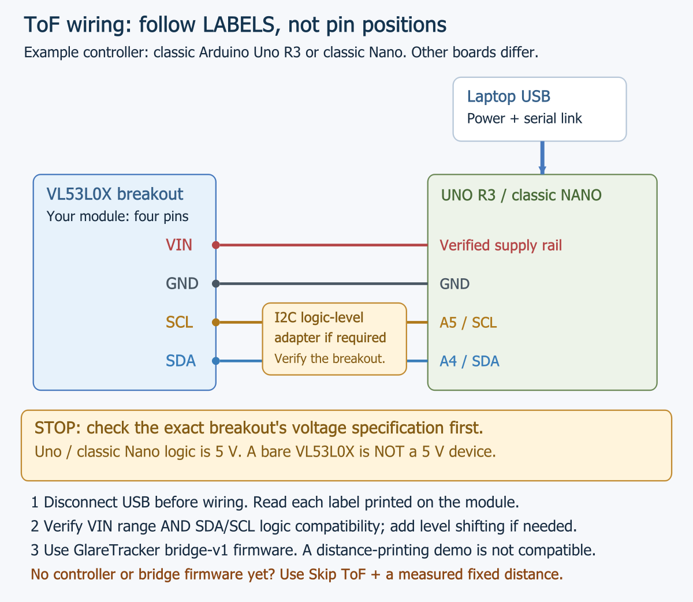
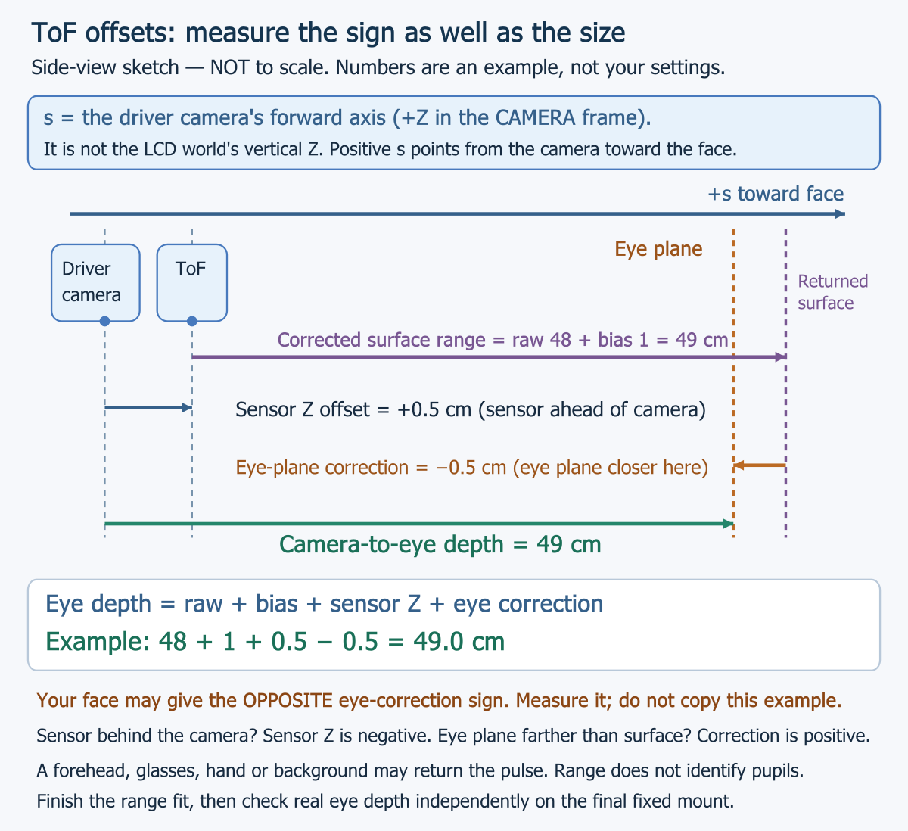

# ToF sensor setup: an offline operator guide

Reviewed: 2026-11-27. Sensor: the purchased four-pin VL53L0X board marked **VIN,
GND, SCL, SDA**. Read the printed labels on your own board; do not copy a pin's
left/right position from a rotated photograph.

**Current project state:** the application can receive and calibrate the specified
sensor messages, but this repository does not contain a completed, hardware-tested
controller firmware build. The user selected **Arduino Nano or Uno** on 2026-11-27.
The wiring below covers **classic ATmega328P Nano or Uno R3**; check the exact board
label before assembly because other Nano/Uno variants differ. The photographs do
not establish the breakout board's power/logic ratings.

This leaves two clear routes:

| What you have | What to do |
| --- | --- |
| No controller, no approved bridge firmware, or uncertain electrical ratings | Use **A. Camera-only bench route** now. Do not select live ToF. |
| Identified controller, verified wiring/power and commissioned GlareTracker bridge v1 | Complete **B–F**, in order. |

An Arduino example that prints a distance number can prove a sensor responds. It
cannot communicate with GlareTracker's current receiver. Do not treat that example
as the required bridge firmware.

## A. Camera-only bench route: works without ToF hardware

1. In the main app, select **Stop**. Expand **Operation > Operating Mode** and
   choose the intended mode. Use **Fully Auto** if both road cameras and the driver
   camera will supply observations.
2. Select the **Cameras** icon and expand **Calibration**. Open
   **2. Driver camera + ToF**, then select the **2. ToF sensor** tab.
3. Click **Skip ToF for now**. Check the ToF indicator says skipped. A skip is not
   a sensor calibration pass. Close the dialog.
4. Select the **Driver** profile icon. Expand **Driver Distance**. Leave
   **Live driver distance** **OFF**.
5. Measure from the driver camera's lens reference straight forward to the eye
   plane. Enter that measured value as **Fixed distance**. For example, enter
   **50.0 cm** only if your reference measurement is 50.0 cm.
6. Keep the subject at that distance during the bench trial. The camera continues
   tracking left/right eye pixels. The distance stays fixed; leaning forward or
   backward makes that assumed distance wrong.

**Ready to continue:** ToF says skipped, Live driver distance is OFF, and the fixed
distance matches the measured bench position. Continue the camera and installed-rig
steps in the [main calibration guide](DRIVER_AND_INSTALLED_RIG_CALIBRATION_GUIDE.md).

## B. Prepare the hardware while internet access is available

Do this preparation before travelling to an offline test location.

1. Have the team identify the controller by its exact printed model. The example
   pin table below applies to an **Arduino Uno R3 or classic ATmega328P Nano**.
   It does not apply automatically to Nano ESP32, Nano 33, Mega or another board.
2. Have the team identify the exact sensor breakout and document its permitted
   VIN voltage and SDA/SCL logic voltage. A board being blue, or having a VIN pin,
   does not establish that it can accept 5 V. Manufacturer-branded carriers can
   include regulators and level shifters; a similar-looking generic board can
   differ. See the [Adafruit carrier pin explanation](https://learn.adafruit.com/adafruit-vl53l0x-micro-lidar-distance-sensor-breakout/pinouts)
   and [Pololu carrier description](https://www.pololu.com/product/2490), which
   describe their own products rather than certify this generic module.
3. Prepare a USB **data** cable, the controller's USB driver, the selected board
   support package and the sensor library. Install them on the actual test laptop.
   A charging-only cable will supply power without creating a COM port.
4. Obtain the team's approved **GlareTracker bridge v1** firmware and its flashing
   instructions. There is no such tested build bundled with the present source.
   Until this item is completed and verified, return to route A.
5. Save this guide, its local figures, the app and calibration PDF on the laptop.
   Confirm the app starts with Wi-Fi disconnected. If using Python source, install
   its dependencies beforehand; installing a package normally requires a network.
6. Save the exact board pinout PDF and carrier specifications. Watch the optional
   videos in section G beforehand. The written procedure and local pictures remain
   the instructions at the test site; web links cannot play without internet.

**Preparation check:** the controller is already programmed and has passed a real
sensor communication check on this laptop. A firmware specification, a downloaded
library or a successful software unit test is not that hardware check.

## C. Wire and mount the four-pin module

### C1. Connect with USB unplugged

The signal assignments for Uno R3 and classic Nano are:

| Printed sensor label | Connection | Meaning |
| --- | --- | --- |
| GND | Controller GND | Shared electrical reference |
| SDA | A4 / SDA, through the approved level shifter if required | Two-way data |
| SCL | A5 / SCL, through the approved level shifter if required | Communication clock |
| VIN | The supply specifically approved for this sensor breakout | Sensor power |

Arduino documents A4/SDA and A5/SCL for these specific boards in the
[classic Nano pinout](https://docs.arduino.cc/resources/pinouts/A000005-full-pinout.pdf)
and [Uno R3 pinout](https://docs.arduino.cc/resources/pinouts/A000066-full-pinout.pdf).

**Power decision before plugging in:**

- If the exact breakout is documented for **5 V supply and 5 V I²C signals**, the
  Uno/Nano **5V** pin may feed its VIN, with SDA/SCL connected as above.
- If the exact breakout requires **3.3 V supply/logic**, use the team's verified
  3.3 V supply and a suitable bidirectional I²C level shifter between it and a
  5 V Uno/Nano. Do not simply attach 5 V SDA/SCL wires to an unprotected sensor.
- If the ratings or circuit are unknown, stop wiring and use route A until the
  team resolves them. The Uno/Nano pin marked **VIN** is not its regulated 5 V
  output; do not join two pins merely because both say VIN.

Use the physical pin labels, not wire colour, to inspect every connection. Do not
add connections to unlabelled holes or try to find extra shutdown pins on this
four-pin board. If the team needs power/current or level-shifter checks, have the
person assembling the electronics do them before the operator plugs it into USB.

### C2. Fix the sensor next to the driver camera

1. Fix both parts to one firm mount so neither can rotate independently.
2. Point the sensor toward the driver's upper face, in the same direction as the
   driver camera. Keep the sensor close to the camera; this first software model
   assumes almost parallel, almost shared viewing axes.
3. Leave the sensor's optical opening unobstructed. Do not place it behind the
   LCD, a dark camera filter, a finger or a new cover window. Check for any shipping
   liner before use; remove it only as the exact carrier's instructions require.
4. Secure the cable so pulling it does not move the mount.
5. Keep this mount unchanged through range calibration and the subsequent test.

The range sensor returns a distance to a surface, not the location of a pupil.
Its illumination is near infrared, but it is not an NIR eye camera. ST's
[VL53L0X product information](https://www.st.com/en/imaging-and-photonics-solutions/vl53l0x.html)
describes the sensor technology; this guide does not certify a distance accuracy
for the purchased generic module.

## D. Connect the commissioned controller to GlareTracker

1. Plug in the assembled, commissioned controller using the USB data cable.
2. Open Windows **Device Manager > Ports (COM & LPT)**. Note which COM entry appears
   when this controller is plugged in. For example, the actual entry might be
   **COM5**. Do not copy COM5 unless that is what this laptop shows.
3. Close Arduino Serial Monitor, terminal programs and any other app holding this
   COM port. Only one program should use the controller's serial port.
4. In GlareTracker choose **Stop**. Open **Cameras > Calibration >
   2. Driver camera + ToF > 2. ToF sensor**.
5. Select or type the observed port in **USB serial port**. The field is editable.
   Click **Connect / reconnect**.
6. Point the sensor at a still, flat target. Wait for **Valid range: … cm** and the
   sensor identity. The displayed value should respond plausibly as you move the
   target nearer and farther.
7. If no valid range appears after about 10 seconds, stop this stage and use the
   troubleshooting table. Repeatedly pressing Capture cannot fix a failed connection.

The bridge must identify itself, synchronize its clock and send fresh valid range
packets. Those requirements are defined in the [bridge v1 specification](../reference/TOF_BRIDGE_PROTOCOL.md).
For a nontechnical operator, the decision is simple: proceed only when real valid
readings appear. Messages such as `Waiting for sensor HELLO` or a JSON/session error
mean the sensor is **not ready** for calibration.

## E. Calibrate measured target distances, then the two offsets

### E1. Collect five separate target positions

Use a flat, stable target facing the sensor and large enough to fill its sensing
area. A small object with background visible around it can return an unexpected
surface distance. Use a stand, a ruler/tape and the same sensor reference surface
for every measurement.

1. Click **Reset captured ToF distances** if starting a fresh calibration, changing
   sensor/mount or replacing questionable measurements. This clears the current
   samples; it preserves an older saved profile until a new successful save.
2. Put the target at the first independently measured distance. Hold it still for
   2–3 seconds with valid readings appearing. Enter that distance in
   **Measured target distance**.
3. Set **Sample use** to **fit** and click **Capture 20 readings**. Read the message:
   the number of captured distances must increase. A button press with an error
   message is not an accepted capture.
4. Move the target, measure again, wait for it to settle and repeat. Collect three
   different fit distances spanning the expected seating range.
5. Set **Sample use** to **validation**. Collect two **new**, different distances.
   Validation means checking the correction against positions not used to calculate it.

Example plan, in centimetres:

| Capture | Sample use | Measured target distance |
| --- | --- | ---: |
| 1 | fit | 30 |
| 2 | fit | 50 |
| 3 | fit | 70 |
| 4 | validation | 40 |
| 5 | validation | 60 |

Use distances you can actually measure and hold, not these numbers by habit. The
app accepts distinct target references from 5 to 150 cm. It requires at least 20
fresh valid readings per captured distance, with stable readings; currently the
standard-deviation limit is 1 cm. The held-out corrected range error must be no
more than 2 cm. These are software acceptance limits, not measured project results.

If you entered a wrong distance or the target moved, use **Reset captured ToF
distances** and repeat the five positions. Do not keep an incorrect sample and
hope that adding more samples will repair it.

### E2. Understand the two signed offsets before entering them

These offsets are along the **driver camera's forward direction toward the driver**.
They are not the installed rig's LCD Y/Z coordinates.

- **Sensor-to-camera Z offset:** the sensor reference's position relative to the
  camera reference along that forward direction. If the sensor sits 0.5 cm farther
  toward the driver than the camera reference, enter **+0.5 cm**. If it sits 0.5 cm
  behind the camera reference, enter **-0.5 cm**. A sideways gap is not this offset.
- **Surface-to-eye Z correction:** the signed forward distance from the surface
  that returns the ToF signal to the independently located eye plane. An eye plane
  farther from the camera is positive; one nearer the camera is negative.

The diagram's arithmetic example only: raw range **48.0 cm**, fitted sensor bias
**+1.0 cm**, sensor offset **+0.5 cm**, and independently measured eye correction
**-0.5 cm** give an eye depth of **49.0 cm**. The application adds these four values. Do not copy any
of these offsets into a real rig.

Have the team establish the eye plane with its reference jig or an independent
side-view measurement. Do not touch an eye with a ruler. A target-board range fit
cannot establish this facial offset, and a zero is valid only when measured.
If the team cannot establish both offsets, return to route A rather than guessing.

### E3. Save, then prove the intended path is active

1. Enter both measured signed offsets in their named fields.
2. Tick **I independently measured both signed offsets**.
3. Click **Fit and Save ToF**. Wait for the **ToF range calibration saved** alert.
   If an error appears instead, no new successful profile has been saved.
4. Close the calibration dialog. Confirm the ToF indicator identifies a calibrated
   range profile, rather than skipped or not connected.
5. In **Driver > Driver Distance**, turn **Live driver distance ON** only when the
   actual sensor/controller is connected and its saved profile is the intended one.
   With this switch OFF, the app intentionally keeps using Fixed distance.
6. Complete the installed-rig calibration and compare the reported eye depth with
   independent measured truth before using ToF in a recorded trial.

The first fusion model only accepts a near-frontal, central face region: approximately
10° pitch/yaw and an eye midpoint within 5° of the camera axis. It also checks freshness
and sensor identity. If a selected ToF return becomes invalid, the app clears measured
output; it does not silently substitute a guessed camera distance. Explicitly skipping
ToF with Live driver distance ON instead selects a camera/IPD bench estimate.

### E4. Reuse a saved profile after reconnecting the same sensor

Use this route only when the physical sensor, its camera mount and both measured
offsets are unchanged. Replacing a sensor requires a new calibration, even if the
controller reports an old identity. The bridge identity is evidence of the
commissioned assembly; it cannot physically inspect which sensor is attached.

1. Select **Stop**. Reopen **Cameras > Calibration > 2. Driver camera + ToF >
   2. ToF sensor**.
2. Check the controller's current COM port in Windows Device Manager. Select or
   type that port in **USB serial port**; do not assume its old number still applies.
3. Click **Connect / reconnect** and wait for fresh **Valid range** messages and the
   same sensor identity used for the saved calibration.
4. Click **Use saved ToF profile**. Read the result below the connection status.
   Success explicitly names the saved sensor and its active COM port. The app can
   now update a changed COM port while preserving the existing calibration values.
5. If it says to reconnect, wait for current valid readings and retry. If it names
   a different sensor, reconnect the original calibrated assembly or collect a new
   calibration for the replacement. A failed reuse leaves the original saved
   profile intact; typing a new COM number alone never transfers its calibration.
6. Close the dialog, verify the intended distance mode and continue the normal
   installed-rig checks before Run.

The confirmation requires a running connection on the selected port and a fresh,
valid bridge packet with the calibrated sensor identity. A stale last reading,
an unplugged controller or an invalid current return does not pass this check.

## F. Recover without guessing

| What you see | What to do next |
| --- | --- |
| No COM port appears | Check the USB data cable, controller driver and exact board. Return to route A if the controller cannot be commissioned before the offline session. |
| Port exists but permission/access error | Close Serial Monitor/other terminal apps; reconnect in GlareTracker. |
| Waiting for HELLO, wrong session, JSON error, or only a number in another serial app | The bridge firmware is missing, mismatched or malfunctioning. Wiring alone will not resolve the app protocol. Use route A until the team fixes it. |
| No or implausible range | Stop and check approved power/logic ratings, labels, loose wires, obstruction and target position. Do not repeatedly save bad data. |
| Not enough fresh valid readings | Hold the target still, wait for valid messages and capture again. Check that the source is real current data rather than a sensor demo or stalled stream. |
| Reference distance already captured | Each of the five target positions must be different; use a new measured validation position. |
| Fit fails | Check entered units, target stability and references. Reset the current samples and recapture all five positions. Saved old profiles are not proof that the new data passed. |
| Controller unplugged, rebooted or moved to another USB port | Stop and follow E4: select the actual COM port, **Connect / reconnect**, wait for valid readings, then **Use saved ToF profile**. A changed port is saved only after the same calibrated sensor identity is confirmed. |
| Use saved ToF profile asks for a reconnect or reports a different sensor | Follow the message; do not try random COM ports. Reconnect the original calibrated sensor and obtain fresh valid readings, or perform a new calibration for a replacement. The original saved profile is preserved. |
| Distance still stays fixed after saving | Check **Live driver distance**. OFF deliberately uses Fixed distance; ON requires the selected sensor to remain valid. |
| Depth fails when the head turns or leaves centre | Return to the declared frontal working region. That restriction is part of this first model; do not defeat it by entering false measurements. |

Before every session, verify the saved profile belongs to this exact sensor/mount.
Moving the sensor changes its offset even if a COM number stays the same.

## G. Optional video references and source documents

These are external references checked on **2026-11-27**. They are background material,
not GlareTracker-specific firmware or button instructions. They are not bundled video
files and will not play without internet. Watch them before the offline visit; save
video only through a download feature the publisher/platform permits. All required
app actions are written above and illustrated by local images.

| Reference | Publisher | What to look for / limitation |
| --- | --- | --- |
| [VL53L0X product demonstration](https://www.youtube.com/watch?v=VxnrHCuABSk) | Adafruit Industries, 2020-09-15 | A physical sensor/target demonstration. The carrier differs from the purchased generic module. The search index exposed the publisher/title; direct YouTube playback was not available in this QA environment. |
| [ST VL53L0X product page — Featured Videos](https://www.st.com/en/imaging-and-photonics-solutions/vl53l0x.html) | STMicroelectronics | Select the introductory ranging/gesture-board video (3:56) for sensor operation; it uses ST evaluation hardware, not this GlareTracker controller. The official page and video listing were verified. |
| [Adafruit illustrated Arduino wiring and basic demo](https://learn.adafruit.com/adafruit-vl53l0x-micro-lidar-distance-sensor-breakout/arduino-code) | Adafruit | Shows the I²C connections and a basic sensor example for its carrier. Its plain demo output does not implement bridge v1. |
| [Adafruit breakout pin descriptions](https://learn.adafruit.com/adafruit-vl53l0x-micro-lidar-distance-sensor-breakout/pinouts) | Adafruit | Explains that this manufacturer's board contains support circuitry; do not assume the same protection on a generic board. |
| [Pololu VL53L0X carrier](https://www.pololu.com/product/2490) | Pololu | An alternative manufacturer's documented regulator/level-shifter design, useful when checking board differences. |
| [Nano pinout PDF](https://docs.arduino.cc/resources/pinouts/A000005-full-pinout.pdf) / [Uno R3 pinout PDF](https://docs.arduino.cc/resources/pinouts/A000066-full-pinout.pdf) | Arduino | Verify A4/SDA and A5/SCL on the exact stated controller. |

## Before a live-ToF trial

- [ ] Correct controller model and breakout voltage/logic ratings identified.
- [ ] Approved bridge firmware commissioned on the test laptop, or route A selected.
- [ ] Local guide images and app open with Wi-Fi disconnected.
- [ ] Controller port and sensor identity are correct; other serial programs closed.
- [ ] Three fit and two new validation target distances accepted.
- [ ] Both signed offsets independently measured and confirmed.
- [ ] New ToF save-success alert observed, or reuse explicitly confirmed the same sensor and current port.
- [ ] Live driver distance deliberately ON for working ToF, or OFF for measured fixed distance.
- [ ] Installed camera-to-LCD calibration completed and real eye-depth/intersections checked.

If an item needed for live ToF cannot be checked, record the reason and use the
declared camera-only bench route. Do not label the session a validated ToF trial.
