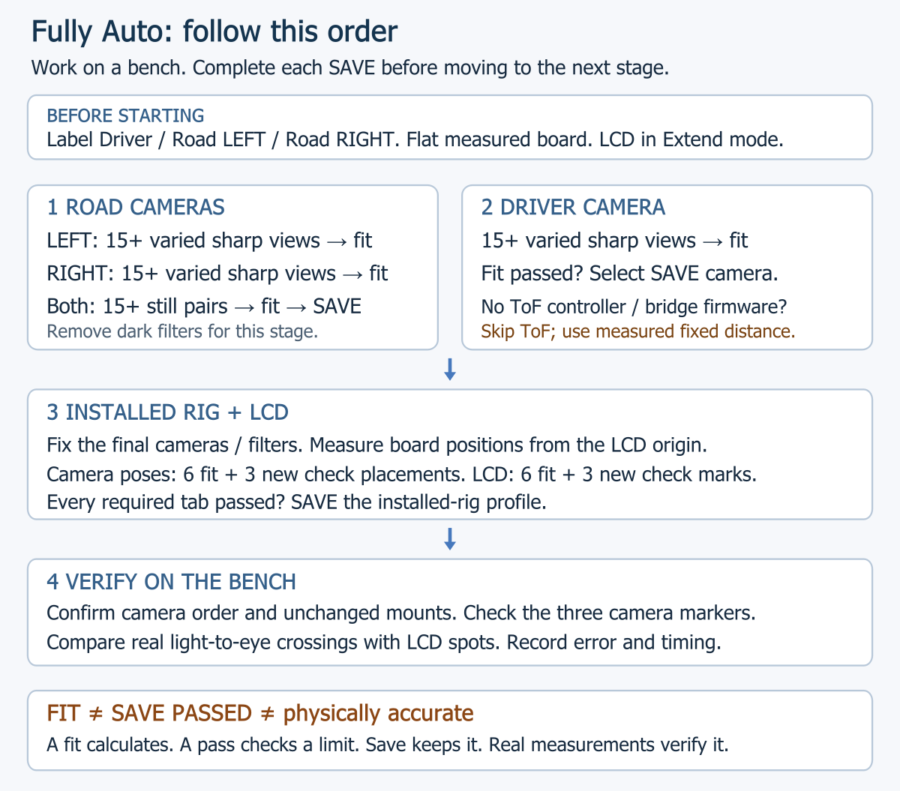
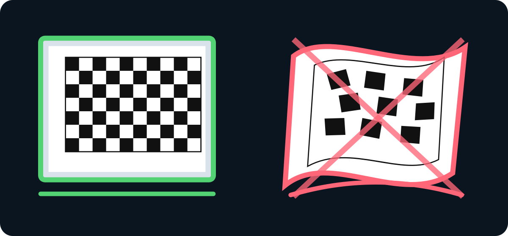
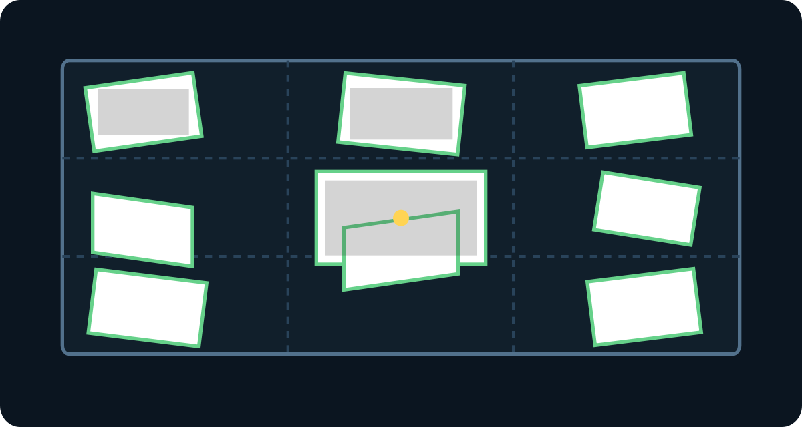
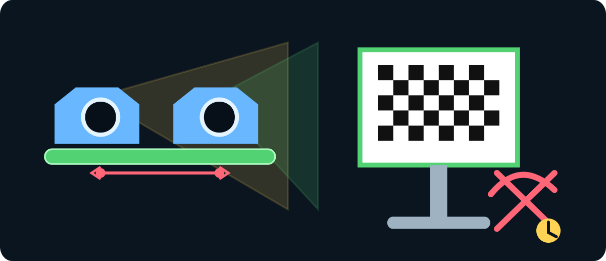
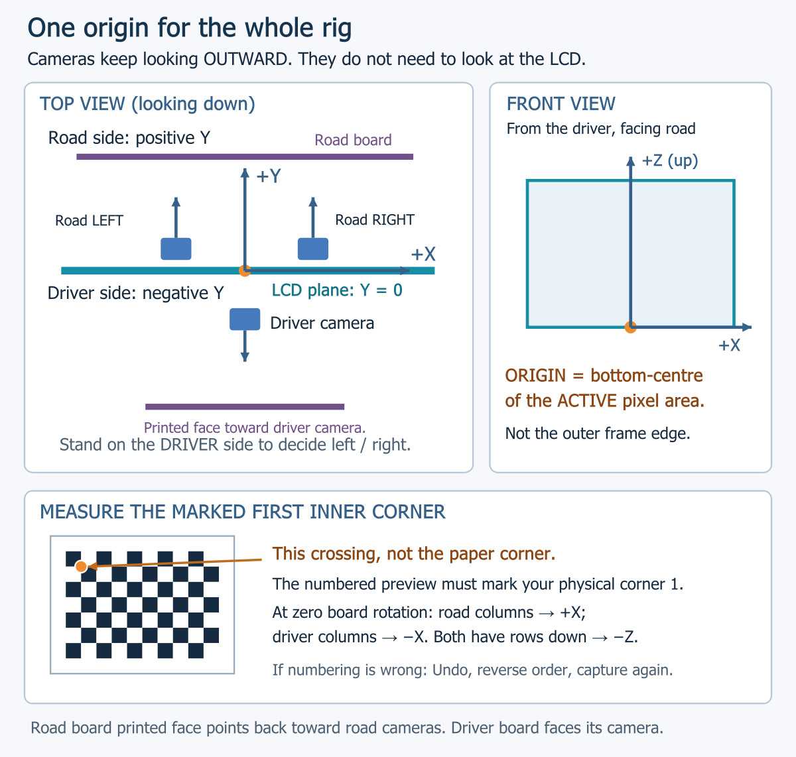

# Visual Road-Stereo Calibration Guide

Updated: 2026-11-27. For two road-facing cameras on a stationary bench.

Start with the [complete bundled offline manual](../../assets/calibration/offline_manual.html).
Its text and local pictures remain available without internet. This page is a shorter
picture-led companion to the [detailed stereo steps](STEREO_CHESSBOARD_SETUP_GUIDE.md).

## 1. Find the current controls

Settings start collapsed. Click the **Cameras** icon, expand **Camera Selection**,
and assign **Driver**, **Road left** and **Road right** using the actual device
identities. Expand **Calibration**, then select **1. Road stereo calibration**.

Stereo is already the normal road-camera setup; no separate setup selection is needed.
Use **Stop**, wait for discovery to finish, and close other camera applications
before opening calibration.

## 2. Make the target rigid and flat

1. Select **Print A4 chessboard...** inside calibration.
2. Print A4 landscape at **Actual size / 100%**, with **Fit to page disabled**.
3. Glue the complete sheet to rigid backing. Remove bubbles and wrinkles.
4. Keep all **10 × 7 squares** and the white border visible; the detector uses
   **9 × 6 inner corners**.
5. Measure several square sides and divide. For example, five sides measuring
   10.0 cm mean **Measured square side = 2.000 cm**.
6. Keep fingers, clips, reflections and shadows away from the pattern.

A loose or curved sheet cannot be corrected by collecting more photographs of it.
The fitting method assumes all corners are on one flat plane.

## 3. Collect useful views, not repeated clicks

Capture at least **15 accepted sharp views for LEFT**, then at least **15 for RIGHT**:

- centre, left, right, top and bottom image regions;
- several near/far distances;
- gentle horizontal and vertical tilts;
- the complete board and border visible each time.

Pause before each capture. The counter increases only for an accepted view. A
rejected near-duplicate or missing-board message means you should correct that
condition before clicking again.

### LEFT stage

**Start LEFT calibration → Capture LEFT view → Fit LEFT intrinsics.**

Wait for the LEFT intrinsic-pass alert before continuing. “Intrinsics” means that
camera’s lens/image model, not its installed position relative to the LCD.

### RIGHT stage

**Start RIGHT calibration → Capture RIGHT view → Fit RIGHT intrinsics.**

Repeat the coverage independently. Do not change square size or crop images to
make apparent zoom equal. Each camera has its own focal length/distortion model.
Correct a native-resolution mismatch before continuing.

## 4. Capture the fixed stereo pair

1. Keep both road cameras rigidly fixed. Measure between lens centres and record
   this **baseline**.
2. Select **Start STEREO calibration**.
3. Place the board on a stand in the overlap of both views.
4. Move it to a new position or gentle tilt, then let it stop completely.
5. Select **Capture pair** and check the accepted-pair counter.
6. Collect at least **15 accepted pairs** at varied depths/image regions.
7. Select **Fit stereo geometry**.

Both images must have the same native dimensions. Ordinary USB captures are
sequential, not hardware-synchronized, so the stationary board matters.

## 5. Tell a fit pass from a saved calibration

A green **STEREO FIT PASSED — NOT SAVED YET** message is not the final step.

- Individual/stereo RMS must be at most **1.5 px**.
- Rectified vertical-row error p95 must be at most **2.0 px**.
- Matrices must be finite and LEFT/RIGHT translation must have the required sign.
- The reported baseline must make sense against the ruler measurement.

Select **Save stereo profile** only after those checks. Look for the saved-success
alert and **CALIBRATION COMPLETE — STEREO PROFILE SAVED**. The dialog then closes.
Software fit limits are not proof of physical accuracy.

**px** means an image pixel. RMS summarises the image fit error; row-error p95 is
the mismatch at or below which 95% of the checked corners fall. They are not
centimetre-accuracy measurements.

If a fit fails, read the message. Correct flatness, blur, rigidity, camera order or
pose coverage. If the session contains bent-board images, start again with a clean
flat-board session. Do not lower limits to force a pass.

## 6. Apply final optics, then complete installation

Apply dark filters without moving/refocusing cameras. Independently check the final
filtered geometry before measurements. If the filters change geometry, repeat the
necessary calibration with a sharp, visible target through the final optical setup.

To see all three calibrated cameras in the scene, use the **Fully Auto** workflow:
save road stereo, save driver intrinsics, then complete and save
**3. Installed rig + LCD** with the road LEFT pose, driver pose and LCD mapping.
Confirm camera order/mounts. Compatible **Driver**, **Road L** and **Road R** markers
then appear in world centimetres; Road RIGHT uses the saved stereo transform.

Stereo alone cannot establish camera-to-panel positions. Missing or mismatched
profiles do not create guessed camera locations. The optional ToF can be skipped
for declared fixed-distance bench work; it does not determine whether saved camera
poses exist.

See [driver and installed-rig steps](DRIVER_AND_INSTALLED_RIG_CALIBRATION_GUIDE.md)
for measured placement, save requirements and physical dark-dot verification.

## 7. Optional video references

The following links require internet and are supplemental explanations. The bundled
manual and pictures contain the instructions needed at the offline test site.

- [MathWorks: Camera Calibration with MATLAB — video and transcript](https://www.mathworks.com/videos/camera-calibration-with-matlab-81233.html).
- [Kevin Wood: camera calibration](https://www.youtube.com/watch?v=H5qbRTikxI4).

Watch or obtain an authorized offline copy before disconnecting, if desired. These
videos do not replace this application’s acceptance checks or exact button sequence.
