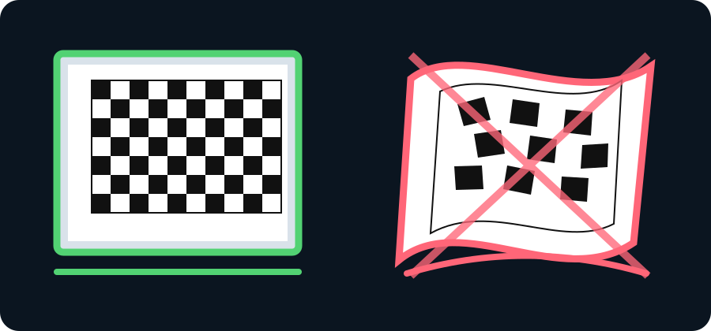
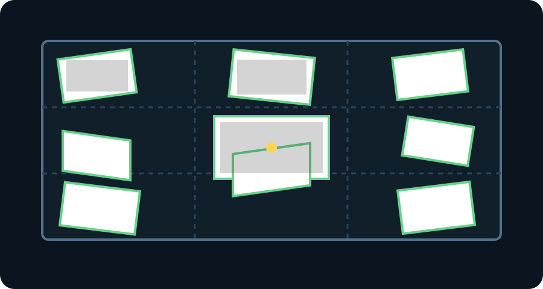
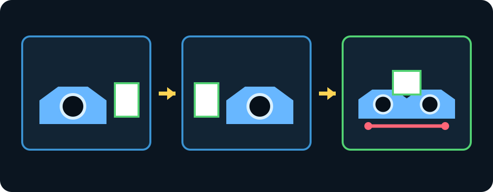

# Visual Road-Stereo Calibration Guide

Use this guide for the two road-facing cameras. Calibration must be performed
without the dark filters first. This is a stationary laboratory procedure.

## 1. Make the target rigid and flat

The calibration model assumes that every checkerboard corner lies on one flat
plane. A loose or curved paper target creates false lens distortion and can produce
a high RMS error even when every corner is detected.

1. Print the supplied board at **Actual size / 100%** with **Fit to page disabled**.
2. Glue the complete sheet to foam board, thick card, wood, or acrylic.
3. Remove bubbles and wrinkles. Confirm the target does not flex when tilted.
4. Measure several squares with a ruler and enter their average side length.
5. Keep fingers, clips, tape, glare, and shadows outside the checkerboard pattern.

## 2. Capture useful pose coverage

Capture 15–20 sharp, genuinely different views for each stage:

- centre, left, right, top and bottom image regions;
- near and far views, with several frames filling roughly one-third to one-half
  of the image;
- moderate horizontal and vertical tilts;
- the complete checkerboard and white border visible in every accepted image.

Do not collect many almost identical views. Do not use motion-blurred images,
extreme angles, a bent sheet, or a board partly outside the image.

## 3. Complete the stages in order

### Stage 1 — LEFT intrinsics

Capture the flat board with only the LEFT road camera. Select **Fit LEFT
intrinsics** after at least 15 varied views. Continue only after the
**LEFT intrinsic calibration passed** alert appears.

### Stage 2 — RIGHT intrinsics

Repeat the complete pose set independently for the RIGHT camera. A different
apparent zoom or field of view is acceptable because each camera receives its own
intrinsic calibration. Both cameras must still share enough scene overlap.
Continue only after the **RIGHT intrinsic calibration passed** alert appears.

### Stage 3 — fixed stereo pair

Rigidly mount the cameras side by side and measure the optical-centre separation.
Do not move, rotate, refocus, or swap them after this point. Capture at least 15
paired poses with the same stationary flat board visible in both feeds, then fit
the stereo geometry.

Compare the reported baseline with the ruler measurement. Select **Save stereo
profile** only when the fit passes and the baseline is physically plausible.

## 4. Know when calibration is complete

Calibration is complete only when the application displays:

> **Stereo calibration complete — profile saved successfully**

If a fit fails, no active stereo profile is replaced. Do not lower the quality
limit to accept curved-board data. Correct the board, lighting, sharpness, pose
coverage, or camera rigidity and repeat the affected calibration from a clean
session.

After saving, apply the dark filters without moving or refocusing either camera.
The filtered arrangement still requires the planned geometric verification and
measured-distance validation before its coordinates are treated as research data.
